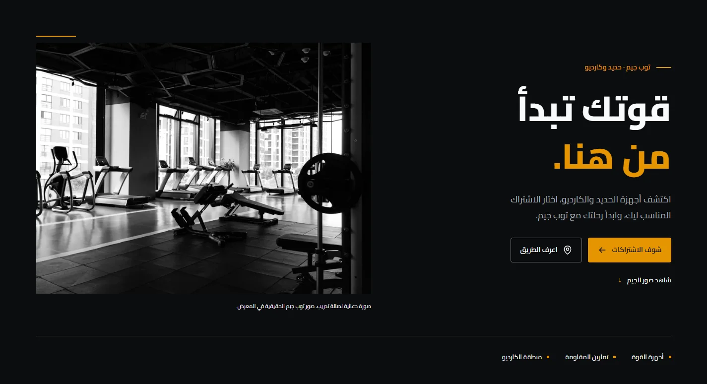

# TOP GYM

A premium Arabic/English gym landing page based on the supplied **Google Stitch Apex Gold** design and authentic TOP GYM equipment photographs. Visitors can explore the gym, compare two membership packages across six durations, view provisional opening hours, call the team, get directions, and join the WhatsApp group.

**Live website:** [TOP GYM](https://top-gym-website.vercel.app/) · [Arabic](https://top-gym-website.vercel.app/ar/) · [English](https://top-gym-website.vercel.app/en/).

The owner authorized merging and publishing PR #11 on November 5, 2026. Vercel now serves the website successfully; the empty-main 404 is resolved. Search indexing remains disabled while business-content and production SEO follow-ups are open. Five supplied certificate copies are visible with registration numbers redacted; original-document comparison and current role confirmation remain outstanding. See [deployment evidence](docs/VERCEL_DIAGNOSIS.md), [progress](docs/PROGRESS.md), and the [remaining checklist](docs/QA_CHECKLIST.md).



[English desktop](docs/evidence/en-1440.webp) · [Arabic mobile](docs/evidence/ar-390.webp) · [English mobile](docs/evidence/en-390.webp) · [Delivery board](https://github.com/users/AhmedSalem104/projects/2)

## Features

- Shared Arabic RTL and English LTR pages, localized copy, EGP prices and times, persistent explicit language choice.
- Original supplied logo; five genuine gym photographs; a spacious-gym promotional hero by Risen Wang with recorded provenance; local fonts.
- Five certificate previews with keyboard-accessible enlargement and privacy-safe copies.
- A visible, scannable WhatsApp-group QR code generated locally during the static build.
- Sticky navigation with one gliding gold spotlight, mobile menu, gallery dialog with keyboard controls and restored focus.
- Premium pre-footer CTA and responsive four-group footer with configured hours, real contact/social links, directions and native Back to Top.
- Reusable native motion across every section, bounded reading-order staggers, accessible menu/dialog transitions and live reduced-motion support. See [motion architecture](docs/MOTION_SYSTEM.md) and the [coverage matrix](docs/MOTION_COVERAGE_MATRIX.md).
- PDF-verified pricing, six keyboard-accessible duration tabs, and a full comparison table; contact-based membership enquiries.
- Africa/Cairo current-day and open/closed calculation with midnight and DST boundary tests.
- Separate Ahmed/Karim phone links, the supplied Maps/Facebook URLs, and clearly labeled WhatsApp **group** access.
- Conditional canonical/hreflang/social metadata, an ExerciseGym schema, sitemap, and robots policy.
- Certificate card/lightbox infrastructure with an explicit publication gate; no placeholder section is shown.
- GitHub Actions, ESLint, TypeScript checks, Vitest, Playwright and axe accessibility checks.
- Private bilingual customer feedback: native star ratings, topic chips, optional reply details, secure server validation, Gmail SMTP notifications and a branded HTML/plain-text email. Delivery is enabled only after private server configuration; see [Customer feedback](docs/CUSTOMER_FEEDBACK.md).

## Stack and architecture

Astro produces static HTML. TypeScript holds business data and small browser enhancements. Tailwind 4 supplies CSS infrastructure alongside the design-specific token stylesheet. One Vercel Node function handles private customer feedback with Nodemailer, Zod and shared Redis rate/idempotency records. No message content is stored in Redis. There is no React runtime, payment flow or tracking script.

Exact package versions are pinned in `package.json` and `package-lock.json`. Fonts are self-hosted through Fontsource: Barlow Condensed, Chivo, and Cairo. Sharp prepares authorized media; Vitest covers data and hours; Playwright/axe cover browser behavior.

```text
.github/                 CI, issue forms and PR template
api/feedback.ts          Vercel server-only feedback endpoint
docs/                    Project memory, provenance, evidence and launch checklist
public/media/            Reviewed web derivatives only
scripts/                 Reproducible media and performance tools
src/
  components/            Shared header, footer, photo, pricing card and dialog
  config/business.ts     Authoritative typed business configuration
  config/motion.ts       Shared native motion tokens, variants and trigger settings
  content/media.ts       Photo captions and accessible alternatives
  i18n/index.ts          Arabic/English UI copy and formatting
  layouts/               Document shell and localized SEO
  pages/                 /, /ar/, /en/, 404, robots and sitemap
  scripts/               Minimal browser interaction logic
  sections/              Landing page sections
  styles/                Tokens, responsive layout and reduced motion
  server/feedback/       Validation, abuse protection, SMTP and email template
  utils/                 Cairo operating-hours calculation
tests/                   Unit and browser tests
```

## Prerequisites and quick start

Install **Node.js 24 LTS**, npm, and Git. Use `node --version` to confirm Node 24 before installing. The initial Windows machine had Node 22.19; implementation validation used an isolated Node 24 runtime without changing the system installation.

```sh
git clone https://github.com/AhmedSalem104/top-gym-website.git
cd top-gym-website
npm ci
npm run dev
```

Open `http://localhost:4321/ar/` or `http://localhost:4321/en/`. `/` renders the configured default language and honors an explicitly saved language choice when JavaScript is available.

```sh
npm run build
npm run preview
```

The production output is `dist/`; preview is local only. No environment variables are required for a review build.

### بداية سريعة

ثبّت Node.js 24، ثم نفّذ `npm ci` و`npm run dev`. العربية متاحة على `/ar/` والإنجليزية على `/en/`. بيانات الجيم والأسعار موجودة في `src/config/business.ts`. لا تنشر الموقع قبل مراجعة قائمة الإطلاق والشهادات ومواعيد العمل.

## Commands and testing

| Command                                   | Purpose                                                          |
| ----------------------------------------- | ---------------------------------------------------------------- |
| `npm run dev`                             | Local development server                                         |
| `npm run build`                           | Generate static production files                                 |
| `npm run preview`                         | Serve the generated build locally                                |
| `npm run typecheck`                       | Astro/TypeScript diagnostics                                     |
| `npm run lint`                            | ESLint checks                                                    |
| `npm run format` / `npm run format:check` | Apply/check formatting                                           |
| `npm test`                                | Price, business-data, localization and Cairo-time tests          |
| `npx playwright install chromium`         | Install the test browser                                         |
| `npm run test:e2e`                        | Functional, responsive, screenshot and axe tests against `dist/` |
| `npm run test:seo`                        | Test production metadata in an isolated reserved-domain build    |
| `npm run test:all`                        | Full application validation                                      |
| `npm audit`                               | Review dependency advisories                                     |

Build before browser tests. Tests automatically start preview if port 4321 is free. Failure traces and screenshots are saved to ignored `test-results/`; `playwright-report/` is the local HTML report. CI uploads both. Curated reviewed screenshots belong in `docs/evidence/`.

## Business content maintenance

**Hero:** the owner-supplied nine-year claim and bilingual service statements live in `business.hero`; the headline and closing invitation use `src/i18n/index.ts`. Keep supplied claims separate from documentary certificate qualifications. See [Hero composition](docs/HERO_REDESIGN.md) and [certificate presentation](docs/CREDENTIALS_PRESENTATION.md) for the current layout and before/after screenshots.

**Contacts and external links:** edit only `business.contacts` or `business.links`. Store international phone values for `tel:` links, local display values, and Arabic/English names. Preserve the WhatsApp group distinction. Do not add `wa.me` numbers, email addresses or new social accounts without approval.

**Memberships:** edit `business.memberships[].prices` after checking a new official price source. Keep explicit values for each duration; do not infer discounts from monthly multiplication. Update `pricingSource`, the independently transcribed fixture in `tests/unit/business.test.ts`, and the verification note. The two-month duration is explicitly 60 days. All displayed cards and the comparison table use the same configuration.

**Hours:** `opens` and `closes` are minutes after local midnight, with `1440` meaning the next midnight, exclusive. Day numbers use Sunday=0 through Saturday=6, displayed Saturday-first. `Intl.DateTimeFormat` uses `Africa/Cairo`, independent of the visitor timezone. Hours remain provisional and are excluded from structured data until confirmed; record confirmation evidence before changing the policy.

**Facilities and trainer:** only describe supported facilities. Certificates are rendered only from approved configuration entries. Follow [content inventory](docs/CONTENT_INVENTORY.md) before adding a certificate image. A holder name does not establish that this is the contact Ahmed or a current TOP GYM trainer.

## Localization

`src/i18n/index.ts` contains parallel natural Arabic and English copy, duration labels, day names and formatters. Numeric business values remain in `business.ts`. `[locale]/index.astro` renders a single component tree for each locale. `Base.astro` sets `lang` and `dir`; logical CSS properties handle most direction changes. Language links preserve the current section. Explicit locale URLs always take priority over saved preference.

## Photos, logo and certificate handling

Original source files remain preserved outside the repository. At the owner’s explicit request, `public/documents/top-gym-memberships-pricing-2026-11-05.pdf` is a byte-identical copy of the official pricing document, with rendered WebP previews and view/download links. Its URL, hash and file size live in `business.pricingSource`; the gitignore exception permits only this approved PDF. When replacing the price list, visually verify all values, update the configuration, previews, manifest and independent price fixture, then rerun the download/hash tests. Public media includes optimized derivatives of the supplied logo and five gym photographs, five redacted certificate copies, and the owner-requested Risen Wang / Unsplash promotional hero. No AI-generated facility or certificate imagery from Stitch is used.

To regenerate derivatives from an extracted folder with `media/` and `stitch/` subdirectories:

```sh
node scripts/prepare-media.mjs /absolute/path/to/extracted-sources
```

The script writes to `public/media/` and updates `docs/asset-manifest.json` with source hashes, dimensions, duplicates, dispositions, and destinations. It never modifies source files. Review every resulting image, including mirror reflections/posters. Only male human imagery is permitted. Add corresponding descriptive alternatives in `src/content/media.ts`.

The logo is the supplied 3D presentation photograph, preserved with its background and proportions. A genuine transparent logo remains desirable; do not trace or fabricate one. Only privacy-safe certificate derivatives are included; opaque redactions are baked into previews and full-size files. Unredacted sources remain private. Original comparison and trainer-role confirmation are outstanding.

Regenerate certificate copies with `node scripts/prepare-certificates.mjs <extracted-source-root>`. The reviewed source hashes and redaction regions are recorded in the asset manifest. The current Hero can be regenerated with `node scripts/prepare-wide-hero.mjs <reviewed-master>`; its verified source hash, photographer and license are in `docs/hero-media.json`. See [Hero redesign](docs/HERO_REDESIGN.md) for before/after captures, responsive composition and navigation changes. No certificate content is generated or reconstructed.

The WhatsApp QR is generated at `/qr/whatsapp.png` from `business.links.whatsappGroup`; changing that central URL and rebuilding updates both the QR and buttons. It does not use an external QR service. Use `PLAYWRIGHT_PORT` to test an existing production preview on another local port while the development server remains available.

## Accessibility and performance

Semantic sections, a skip link, visible focus rings, native select/details/dialog controls, 44px-or-larger primary touch targets, reduced motion, readable contrast and RTL layouts are built in. The dialog traps keyboard focus, supports Escape/arrow navigation and restores the opener. Gallery links still open the image without JavaScript; the comparison table exposes every price without it.

The hero has high-priority responsive image loading. Below-the-fold imagery is lazy loaded; fonts are local with swap behavior; the browser script is shared and small. Actual measurements and viewport evidence are recorded in [QA](docs/QA_CHECKLIST.md), not inferred from these architectural choices. Lighthouse scores are lab measurements, not real-user guarantees.

## SEO and deployment preparation

Copy `.env.example` to `.env` only when needed:

| Variable           | Meaning                                                       |
| ------------------ | ------------------------------------------------------------- |
| `SITE_URL`         | Confirmed HTTPS production origin; no invented default        |
| `PUBLIC_INDEXABLE` | `false` during review; set `true` only after release approval |

Without an approved domain, canonical/hreflang and absolute social URLs are omitted, sitemap is empty, and robots disallows crawling. With an approved origin, both locales get canonical and alternate links and branded social metadata. The root is a nonindexed preference entrypoint. Structured data never invents address, coordinates, ratings, trainer identity or confirmed hours.

Deploy through the linked Vercel project after completing [deployment preparation](docs/DEPLOYMENT.md). It serves `dist/` and builds `api/feedback.ts` as a Node function. A static-only host cannot send feedback. CI validates without production secrets or real mail. The owner has authorized publication of this update through the protected PR workflow.

## Git workflow and project status

Work on small feature branches, use conventional commits, run relevant checks and open a reviewable PR. Do not reset others’ work, force-push, or commit archives, source certificates, private files, or credentials. This repository was empty at audit; its empty protected `main` baseline now supports [draft PR #11](https://github.com/AhmedSalem104/top-gym-website/pull/11). Website code remains on `feat/top-gym-website` until an explicitly authorized merge. See [project organization](docs/ROADMAP.md) for the actual tracker and release status.

## Troubleshooting

- **Unsupported Node:** activate Node 24 and reopen your terminal. On Windows, `npm.ps1` can use the Node beside its installation even if another `node.exe` is on PATH. Invoke the intended Node with npm’s CLI explicitly if necessary.
- **PowerShell execution policy:** use `npm.cmd` if PowerShell blocks `npm.ps1`; do not weaken system policy for this project.
- **Missing browser:** run `npx playwright install chromium`; Linux CI uses `--with-deps`.
- **Stale preview:** rebuild after changes when using `npm run preview`. Use `dev` for live reload.
- **Port conflict:** close the process using 4321 or change both preview and Playwright configuration consistently.
- **Missing canonical/sitemap entries:** configure the real `SITE_URL` and the intended indexing policy, then rebuild.
- **Certificate changes:** update approved records and the redaction manifest; never replace published copies with unredacted originals.
- **Dependency audit:** `minimatch` is explicitly pinned to patched 11.0.1 through overrides; validate lint and tests after changing it. Do not use forced audit upgrades blindly.

## Documentation and credits

Start with [project brief](docs/PROJECT.md), [architecture](docs/ARCHITECTURE.md), [design system](docs/DESIGN_SYSTEM.md), [decisions](docs/DECISIONS.md), [roadmap](docs/ROADMAP.md), and [progress](docs/PROGRESS.md).

TOP GYM owns/provides the brand and business content. Visual direction: supplied Google Stitch Apex Gold export. Equipment photographs and enhanced copies: supplied by the owner; archive README describes conservative enhancement. Typeface licensing is retained in the installed Fontsource packages. Source assets are not licensed here for unrelated reuse. The promotional wide-gym Hero uses [Risen Wang’s photograph](https://unsplash.com/photos/gym-equipment-inside-room-20jX9b35r_M) under the [Unsplash License](https://unsplash.com/license), with promotional provenance retained separately from actual TOP GYM photography. The old Pinterest portrait is no longer referenced by the Hero. No invented reviews or generated certificate images are published.

The current header adds a single subtle gold spotlight above the active desktop link and a clean mobile active underline; section tracking follows clicks and scrolling. The location section embeds the exact owner-supplied Google Maps place and opens that same original URL when any part of the map card is selected. See `docs/map-verification.json` for provenance and behavior.

Current footer review: [Arabic desktop](docs/evidence/footer-after-ar-1440.webp) · [Arabic mobile](docs/evidence/footer-after-ar-390.webp) · [English tablet](docs/evidence/footer-after-en-768.webp) · [pre-footer CTA](docs/evidence/footer-cta-after-en-1440.webp).
