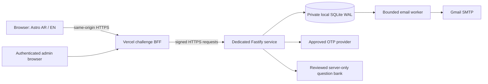

# Fitness challenge — implementation and approval boundaries

## Current status

Gate 1 implementation was explicitly authorized by the owner after the read-only infrastructure audit. This feature is implemented for local review on `feat/fitness-challenge`. **It is not activated on Vercel or installed on the VPS.** Gate 2 requires an approved isolated staging environment and permission for state-changing staging tests. Gate 3 requires separate production approval. These specific gates override earlier standing website publication instructions.

The implementation does not create a gym membership, process payments, or integrate a member portal. Existing website prices, contacts, hours, gallery, certificates, feedback and hero are preserved.

## Implemented journey

1. An opt-in, lightweight floating button opens a native accessible dialog. Arabic RTL and English LTR share one controller.
2. Rules disclose one attempt, three questions, five server seconds per question, latency implications and uninterrupted expiry when disconnected.
3. An Egyptian number is normalized, rate-limited and verified through the selected OTP adapter. Local preview uses mock OTP and clearly invalid sample coupons.
4. A unique phone identity starts exactly one persisted session. Three distinct questions and shuffled opaque answer IDs are selected server-side using cryptographic randomness.
5. Each accepted answer advances atomically. Timeouts persist and advance from the previous deadline, including while the browser is closed.
6. The backend calculates `score × 10`: 0%, 10%, 20% or 30%. The result is available before the name form. Eligible results receive a short count-up and finite gold confetti; reduced-motion users receive a static result.
7. Name, optional email and participation consent finalize the record. Marketing consent is separately optional and does not send marketing messages.
8. Finalization atomically stores one participant, at most one coupon, first-party events and durable notification jobs. Zero score creates no coupon.
9. Administration authenticates with password plus TOTP, searches participants, reviews answers, checks coupon terms, and atomically redeems once.

## Architecture



- `services/challenge`: isolated Node 24 / TypeScript / Fastify 5 service. Own locked dependencies, tests and build. SQLite 3.53.4 is bundled by the installed better-sqlite3 version.
- `api/challenge/[...path].ts`, `src/server/challenge-gateway.ts`: route-allowlisted Vercel BFF. No SQLite or question-bank dependency in Vercel.
- `src/components/Challenge.astro`, `src/scripts/challenge*.ts`, `src/styles/challenge.css`: lazy client experience and first-party attribution. No animation framework or React hydration.
- `src/pages/[locale]/challenge-admin.astro`: noindex administration shell; every data/action endpoint requires backend authentication. A five-click footer detail reveals the entry link only.
- `content/challenge`: 300 original bilingual **draft** questions, excluded from Vercel uploads and public assets. Production validation rejects every unreviewed entry.
- `deploy/challenge`: unexecuted Docker/Compose/Caddy templates and deliberately invalid commercial-policy example.

## Security and privacy model

The browser receives only the current question with opaque shuffled option IDs, server time and the persisted deadline. Correct answers, future questions, coupon creation and scores remain server-side. Phone identity has a database uniqueness constraint independent of cookies, IP addresses or browser storage. Re-verifying the same phone resumes the same attempt, even on another device.

Participant data, phone numbers, TOTP seeds and coupon codes use AES-256-GCM. Exact-match phone/name/coupon lookups use keyed HMAC, not unsalted predictable hashes. Independent encryption, lookup and gateway keys must be backed up privately. This is application-level protection, **not whole-database encryption**: metadata, administrators' email addresses, questions and timestamps remain readable to a database-file holder. Encrypted off-host backups and restrictive OS permissions are required.

Admin passwords use Argon2id (64 MiB, three passes), TOTP enforces single-use time steps, sessions expire after 30 minutes idle or eight hours absolute. Two concurrent password checks cap hashing memory. Roles are viewer, redeemer and owner. Only owners can read audit history. The hidden entry is never authentication. There is no default production administrator.

Same-origin cookies are HttpOnly/Secure/SameSite=Lax in production. Origin checks protect POSTs; admin mutations additionally require CSRF tokens. The BFF signs method, exact path/query, body, timestamp, nonce and trusted platform client IP. The VPS rejects unsigned, stale or replayed requests. Request bodies are bounded to 8 KiB. Direct browser-to-VPS CORS access is unnecessary and not enabled. Never trust an arbitrary forwarded IP header outside the approved Vercel path.

Only session-scoped first-party event deduplication is stored in browser sessionStorage. No fingerprint, Meta Pixel, GA4, advertising identifiers or automatic public testimonials are included. Lead registration and redemption are distinct events; neither proves a paid membership or revenue.

## Local review

Use Node 24 and npm. Commands run from the repository root:

```sh
npm ci
npm run challenge:install
npm run challenge:build
npm run challenge:preview:build
npm run challenge:preview
```

Open `http://127.0.0.1:4340/ar/` or `/en/`. The harness binds loopback, uses an in-memory database, sends **no SMS or email**, and resets on restart. It rejects production/Vercel execution. OTP is `246810` locally. Synthetic predictable questions are the default for automation.

The opt-in build lives in `.local/challenge-preview`, separate from the normal `dist/` output. Challenge reports and traces live under `.local/challenge-report`, `.local/challenge-results.json` and `.local/challenge-test-results`.

To preview the actual 300 draft questions, set `CHALLENGE_PREVIEW_BANK=real` before `npm run challenge:preview`. In PowerShell: `$env:CHALLENGE_PREVIEW_BANK='real'`. Do not share the loopback harness through a public tunnel.

The local-only administrator is `local-admin@example.test`, password `Local-test-password-only!`. `http://127.0.0.1:4340/__test/totp` provides the test authenticator code. These are explicitly non-production fixtures, never valid deployment credentials. The entry is the small footer brand dot clicked five times within 2.5-second intervals, or the local `/ar/challenge-admin/` route.

```sh
npm run challenge:test
npm run challenge:bank
npm run challenge:preview:build
npm run challenge:e2e
npm run challenge:email
```

Normal `npm run build` leaves the challenge hidden unless `PUBLIC_CHALLENGE_ENABLED=true` is explicitly configured. Do not confuse building a local opt-in preview with enabling the deployed feature.

## Remaining activation decisions

1. Approve a TOP GYM API hostname, DNS owner and isolated staging origin/data directory. Existing LogicFit hostnames are not implicitly authorized for this service.
2. Approve an OTP provider, Egyptian delivery requirements and cost cap. A Twilio Verify adapter exists as an option; no account, purchase, SMS or live verification has occurred.
3. Approve eligible packages/durations, expiration, first-time-customer rules, combining offers and localized terms. `policy.example.json` intentionally fails validation.
4. Complete qualified scientific and bilingual review of all 300 questions, plus actual difficulty/reading-time review. See [question review](QUESTION_BANK.md).
5. Resolve the fixed five-second accessibility/fairness limitation explicitly. No extra time or client-authoritative extension has been silently introduced.
6. Approve retention, privacy notice/contact process, administrative operators and MFA recovery procedure. Erasing identity history conflicts with a lifetime one-attempt rule; that policy needs an explicit decision.
7. Configure private SMTP and optional customer-email policy for the new VPS service. Verify a real authorized test inbox and Gmail rendering in staging. Existing feedback credentials were not copied.
8. Approve Gate 2; validate load, Docker image, HTTPS, OTP, mail, backups, restore, operators and regressions. Then request Gate 3 separately.

## Further documentation

[API and schema](CHALLENGE_API.md) · [Operations and rollback](CHALLENGE_OPERATIONS.md) · [Question bank](QUESTION_BANK.md) · [QA evidence](CHALLENGE_QA.md) · [Read-only audit](CHALLENGE_AUDIT.md).
